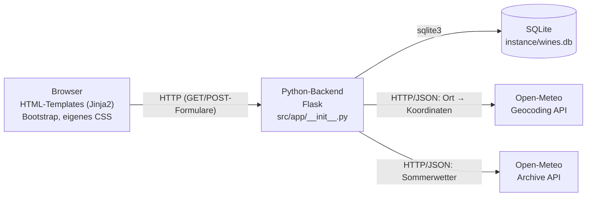
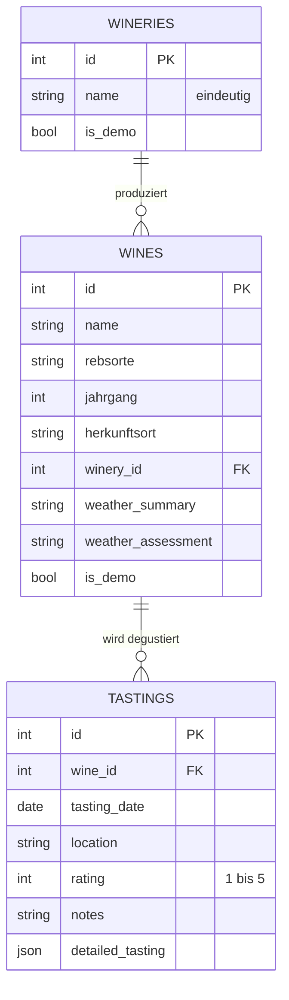

# Weindegustation-WebApp

Eine kleine Flask-Webanwendung zum Erfassen von Weinen und Degustationen.
Die Anwendung speichert die Daten in einer lokalen SQLite-Datenbank und zeigt
zusätzlich historische Sommerwetterdaten zum Jahrgang und Herkunftsort an.

**Live-Version:** <https://weindegu-webapp.onrender.com/>
(Gratis-Plan: Der erste Aufruf nach längerer Pause kann bis zu einer Minute
dauern, weil Render die App erst wieder startet.)

## Architektur



Die Seiten werden serverseitig von Flask gerendert; es gibt keinen
Frontend-Build-Schritt. Die Wetterdaten werden beim Speichern eines Weins
abgefragt und in der Datenbank zwischengespeichert.

### Datenmodell



Wichtige Architekturentscheide sind in [docs/decisions](docs/decisions)
festgehalten.

## Voraussetzungen

- Python
- [uv](https://docs.astral.sh/uv/) als Python-Abhängigkeitsmanager

## App lokal starten

Öffne ein Terminal im Projektordner `weindegu-webapp` und installiere zuerst
die Abhängigkeiten:

```powershell
uv sync
```

Starte die Anwendung unter Windows mit Waitress:

```powershell
$env:PYTHONPATH="$PWD\src"
uv run waitress-serve --listen=127.0.0.1:8080 app:app
```

Die Anwendung läuft danach unter:

```text
http://127.0.0.1:8080/
```

Der Terminalprozess muss während der Nutzung weiterlaufen. Zum Beenden drücke
`Strg+C`.

Falls Windows-Sicherheitsrichtlinien (z.B. auf Firmen- oder
Schullaptops) das Ausführen von `waitress-serve.exe` blockieren, funktioniert
derselbe Start über den Python-Interpreter:

```powershell
$env:PYTHONPATH="$PWD\src"
uv run python -m waitress --listen=127.0.0.1:8080 app:app
```

Für einen anderen Port ändere nur die Adresse:

```powershell
$env:PYTHONPATH="$PWD\src"
uv run waitress-serve --listen=127.0.0.1:8081 app:app
```

Die Anwendung ist dann unter `http://127.0.0.1:8081/` erreichbar.

Die Linux-Alternative ist Gunicorn:

```bash
PYTHONPATH=src uv run gunicorn --bind 0.0.0.0:8000 app:app
```

## Hauptfunktionen

### Weinmodus

Im Weinmodus können Namen, Rebsorten, Jahrgänge, Herkunftsorte und Winzer
erfasst, bearbeitet oder gelöscht werden.

Beim Speichern oder Aktualisieren eines Weins wird anhand des Herkunftsorts
eine Geoposition ermittelt. Danach werden historische Daten für die
Sommermonate geladen:

- Nördliche Hemisphäre: Juni bis August
- Südliche Hemisphäre: Februar bis April

Die Anzeige enthält die mittlere Tagestemperatur und die gesamte
Niederschlagsmenge. Zusätzlich zeigt die Anwendung eine konservative,
grobe Einschätzung von Wärme-, Trockenheits- und Niederschlagsrisiken.

Für bereits vorhandene Weine kann das Wetter in der Weinliste über den
Aktualisierungssymbol-Button erneut abgefragt werden.

### Degustationsmodus

Der **Degustationsmodus** ist über einen deutlich sichtbaren Umschalt-Button
mit Glas-Icon erreichbar. Dort können Degustationen mit Datum, Ort, Bewertung,
Notizen und detaillierten Tasting-Angaben verwaltet werden.

Die Umschaltung ist auf allen Wein- und Degustationsseiten als beschrifteter
**Weinmodus**- und **Degustationsmodus**-Button mit passendem Icon sichtbar.
Der aktive Modus wird blau hervorgehoben.

## Demodaten

Ist beim Start der App noch kein Wein erfasst, werden automatisch drei
Beispielweine mit je einer Degustation eingefügt. Diese Datensätze sind in der
Datenbank mit `is_demo = 1` markiert. Solange Demodaten vorhanden sind, zeigt
der Weinmodus den Button **Demodaten löschen**. Er entfernt nur die
Demodaten; selbst erfasste Weine bleiben erhalten.

Hintergrund: Auf dem Gratis-Plan von Render ist das Dateisystem nicht
dauerhaft. Nach jedem Deploy oder Neustart ist die SQLite-Datenbank leer und
wird wieder mit Demodaten gefüllt (siehe
[ADR 0009](docs/decisions/0009-demo-data.md)).

Lokal kann die Datenbank jederzeit auf die Demodaten zurückgesetzt werden.
**Achtung:** Das löscht alle Weine, Winzer und Degustationen.

```powershell
uv run python seed.py
```

## Wetter-API

Die Anwendung verwendet:

- Open-Meteo Geocoding API zur Ortsauflösung
- Open-Meteo Archive API für historische Wetterdaten

Die Daten werden einmalig beim Speichern beziehungsweise durch den
Aktualisierungssymbol-Button abgefragt und in SQLite gespeichert. Ein API-
oder Ortsfehler verhindert nicht das Speichern eines Weins.

## Tests

Die Testsuite ausführen:

```powershell
uv run python -m pytest
```

(`uv run pytest` funktioniert ebenfalls, sofern Windows das Ausführen von
`pytest.exe` nicht blockiert.)

## Deployment

Die App läuft als Web Service auf [Render](https://render.com/) unter
<https://weindegu-webapp.onrender.com/>. Render ist mit diesem
GitHub-Repository verbunden und deployt jeden Push auf `master`
automatisch (Auto-Deploy). Ein Merge eines Pull Requests auf `master` führt
also direkt zu einer neuen Version der öffentlichen App.

Einschränkungen des Gratis-Plans:

- Die App schläft nach einer Inaktivitätsphase ein; der erste Aufruf dauert
  dann länger.
- Das Dateisystem ist nicht dauerhaft: Selbst erfasste Daten gehen bei einem
  Neustart oder Deploy verloren, danach sind wieder die Demodaten vorhanden.

Die Begründung für Flask, SQLite und Render steht in
[ADR 0008](docs/decisions/0008-technology-and-hosting.md).

## Docker

Mit installiertem Docker kann die Anwendung auch als Container gestartet
werden:

```powershell
docker build . -t webapp
docker run -p 8000:8000 webapp
```

Danach ist die Anwendung unter `http://localhost:8000` erreichbar.
